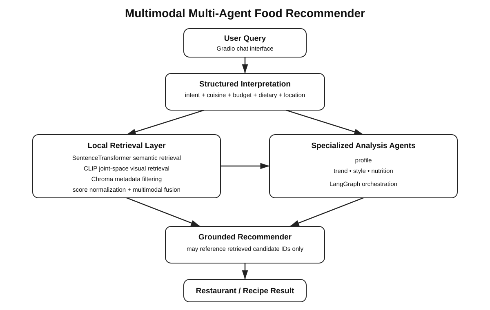

# Multimodal Multi-Agent Food Recommendation System

A multimodal food recommendation application that combines local retrieval, structured LLM reasoning, Vietnamese food knowledge, and optional live web search.

The system supports restaurant, dish, and recipe queries. It retrieves candidates from a persistent Chroma index, combines text and visual-semantic signals, applies preference-aware reranking, and uses LangGraph-orchestrated agents to produce grounded recommendations.



## Features

- Restaurant, dish, and recipe intent routing
- Structured preference extraction for cuisine, budget, atmosphere, dietary needs, and location
- SentenceTransformer semantic retrieval
- CLIP-based visual-semantic retrieval
- Persistent ChromaDB collections
- Multimodal score fusion and preference-aware reranking
- Vietnamese dish and review knowledge from public datasets
- Optional Tavily web search for current or missing restaurant information
- Structured Pydantic outputs for LLM calls
- LangGraph orchestration for profile, trend, style, nutrition, and recommendation agents
- Candidate grounding so final recommendations must reference retrieved or web-grounded candidates
- Source links for web-derived restaurant recommendations
- Gradio chat interface
- Retrieval evaluation and automated tests

## Architecture

```text
User query
   |
   v
Intent classification
   |-----------------------------|
   |             |               |
restaurant      dish           recipe
   |             |               |
   v             v               v
Local retrieval from Chroma
   |
   +-- SentenceTransformer text retrieval
   +-- CLIP visual-semantic retrieval
   +-- metadata / strict-constraint filtering
   +-- multimodal fusion
   +-- preference-aware reranking
   |
   v
Optional Tavily search
   |
   +-- current / nearby / open-now requests
   +-- weak or missing local restaurant matches
   +-- structured RestaurantWebEvidence extraction
   |
   v
Merged grounded candidates
   |
   v
LangGraph analysis agents
   +-- profile
   +-- trends
   +-- style
   +-- nutrition
   |
   v
Grounded recommendation agent
   |
   v
Gradio response
```

The LLM is used for structured language reasoning and recommendation synthesis. Embedding generation, vector retrieval, filtering, fusion, and most ranking operations remain deterministic application logic.

## Repository structure

```text
.
├── app.py
├── src/
│   ├── agents/          # structured LLM agents and schemas
│   ├── data/            # loaders and normalization code
│   ├── embeddings/      # SentenceTransformer and CLIP wrappers
│   ├── retrieval/       # Chroma search, fusion, reranking, web fallback
│   ├── tools/           # Tavily client
│   ├── ui/              # Gradio chatbot integration
│   └── workflow/        # LangGraph orchestration
├── scripts/
│   ├── preprocess_data.py
│   ├── download_vietnamese_data.py
│   ├── download_external_data.py
│   ├── build_index.py
│   └── smoke_test.py
├── evaluation/
├── tests/
├── data/
└── assets/
```

## Requirements

Python 3.11+ is recommended.

Create a virtual environment and install dependencies:

```bash
python -m venv .venv
source .venv/bin/activate
# Windows: .venv\Scripts\activate

pip install -r requirements.txt
```

## Configuration

Copy the example environment file:

```bash
cp .env.example .env
```

Configure the required OpenAI key and, optionally, Tavily web search:

```text
OPENAI_API_KEY=your_openai_key
OPENAI_MODEL=gpt-4.1-mini

TAVILY_API_KEY=your_tavily_key
ENABLE_WEB_SEARCH=true
```

`TAVILY_API_KEY` is optional. If Tavily is disabled or unavailable, the application continues using local retrieval only.

Do not commit `.env` or API keys.

## Data

The project uses two kinds of data:

1. Bundled restaurant and recipe records used by the local recommendation index.
2. Optional external datasets that enrich Vietnamese dish, review, and recipe knowledge.

### Vietnamese datasets

The Vietnamese normalization pipeline supports:

- `HoagMin/Vietnamese_StreetFood_Dataset`
- `Tamir39/foodlensvn`
- `phuongnt101/VLSP2018-ABSA-Restaurant`

Download and normalize them with:

```bash
python scripts/download_vietnamese_data.py
```

Generated files are written under:

```text
data/normalized/
├── dishes.jsonl
├── reviews_vi.jsonl
└── images/
```

The normalization layer preserves source provenance and does not invent restaurant names, addresses, ratings, prices, or other unsupported metadata.

### Optional external recipe and review data

Additional data can be downloaded with:

```bash
python scripts/download_external_data.py --recipe-limit 1000 --review-limit 5000
```

Generated files are stored under `data/external/`.

For development, use bounded limits. Large recipe datasets can be expensive to download and index in full.

## Build the vector index

After preparing the data, build the persistent Chroma index:

```bash
python scripts/build_index.py
```

The index contains required restaurant and recipe collections plus optional Vietnamese collections when normalized data is available:

```text
restaurants_text
restaurants_image
recipes_text
recipes_image
dish_text
dish_image
review_text
```

The first build may download the configured SentenceTransformer and CLIP models.

## Run the application

```bash
python app.py
```

The Gradio interface accepts restaurant, dish, and recipe questions.

Example prompts:

```text
Find me a Vietnamese restaurant for dinner with spicy food and a moderate budget.

What Vietnamese dish would you recommend if I want noodles, beef, and something spicy?

Give me a Vietnamese-style noodle recipe with simple ingredients.

Find a real Vietnamese restaurant that is open now in District 1.
```

You can also run a command-line smoke test:

```bash
python scripts/smoke_test.py "Find me a cozy Japanese restaurant"
```

## Retrieval behavior

### Local retrieval

The application retrieves from Chroma using text and visual-semantic channels. Results are fused and reranked using explicit preference signals.

Cuisine, budget, atmosphere, and location are normally soft preferences. Explicit wording such as `must`, `only`, `exactly`, or equivalent Vietnamese terms can produce strict constraints.

### Dish retrieval

Dish-oriented questions search the Vietnamese dish collections directly instead of being forced through restaurant retrieval.

Examples include:

```text
What Vietnamese dish has beef noodles and a spicy broth?

What is similar to bún bò Huế but less spicy?
```

### Web search fallback

Tavily can be used when a request needs current external information, such as:

```text
open now
current
nearby
real restaurant
recent
```

It can also be used when local restaurant retrieval does not provide a strong match.

Tavily results are normalized into structured evidence before they can enter the recommendation pipeline. Missing fields remain unset rather than being inferred. Web-derived recommendations include their source URL.

## Grounding rules

The application is designed around several constraints:

- Final recommendation IDs must come from the candidate set.
- Web restaurant candidates must be supported by source evidence.
- Missing web metadata is left null rather than guessed.
- Explicit cuisine conflicts are rejected instead of presenting obviously wrong fallback restaurants.
- If no sufficiently relevant candidate is available, the application can return a no-match response instead of inventing an option.

## Testing

Run the test suite with:

```bash
pytest -v
```

Tests cover configuration, data normalization, embeddings, filtering, retrieval, multimodal fusion, preference reranking, structured outputs, LangGraph workflow behavior, Vietnamese dish retrieval, Tavily fallback behavior, grounding, and no-result handling.

Tests use mocked providers where possible so paid API calls are not required for normal unit testing.

## Evaluation

Retrieval evaluation utilities live under `evaluation/`.

Run:

```bash
python evaluation/evaluate_retrieval.py
```

The evaluation code supports metrics such as:

- Precision@K
- Recall@K
- Mean Reciprocal Rank (MRR)
- Hit Rate@K

Evaluation data should be treated separately from tuning data. Small experimental query sets are useful for debugging retrieval behavior but are not sufficient to establish general performance on unseen real-world food queries.

## Running in Google Colab

```python
!git clone https://github.com/NguyenTran2312/Multimodal-Multi-agent-Recommendation-System.git
%cd Multimodal-Multi-agent-Recommendation-System

!pip install -r requirements.txt
```

Set environment variables:

```python
import os

os.environ["OPENAI_API_KEY"] = "YOUR_OPENAI_KEY"
os.environ["OPENAI_MODEL"] = "gpt-4.1-mini"
os.environ["TAVILY_API_KEY"] = "YOUR_TAVILY_KEY"
os.environ["ENABLE_WEB_SEARCH"] = "true"
```

Prepare optional Vietnamese and external data:

```python
!python scripts/download_vietnamese_data.py
!python scripts/download_external_data.py --recipe-limit 1000 --review-limit 5000
```

Build the index and run tests:

```python
!python scripts/build_index.py
!pytest -v
```

Run the app:

```python
!python app.py
```

For Colab, Gradio may need `share=True` in the launch configuration to expose a public URL.

## Error handling

The application handles common runtime failures including:

- missing API keys;
- missing vector indexes;
- malformed local data;
- missing optional Vietnamese collections;
- invalid image references;
- empty retrieval results;
- provider failures;
- unsupported web metadata;
- recommendation IDs that were not retrieved.

External search failure does not invalidate the local retrieval path.

## Limitations

- The bundled restaurant catalogue is small and does not represent comprehensive real-world restaurant coverage.
- Vietnamese public datasets primarily provide dish, image, QA, and review knowledge rather than a verified restaurant directory.
- Tavily search results depend on the quality and freshness of indexed web sources.
- Current web evidence can be incomplete; missing rating, price, opening-hours, or menu fields are intentionally not fabricated.
- The optional recipe corpus can be large and expensive to index fully.
- Retrieval quality should be measured on a larger independently labeled evaluation set before making production-quality claims.

## License

See the repository license for usage terms. External datasets remain subject to their respective licenses and terms of use.
